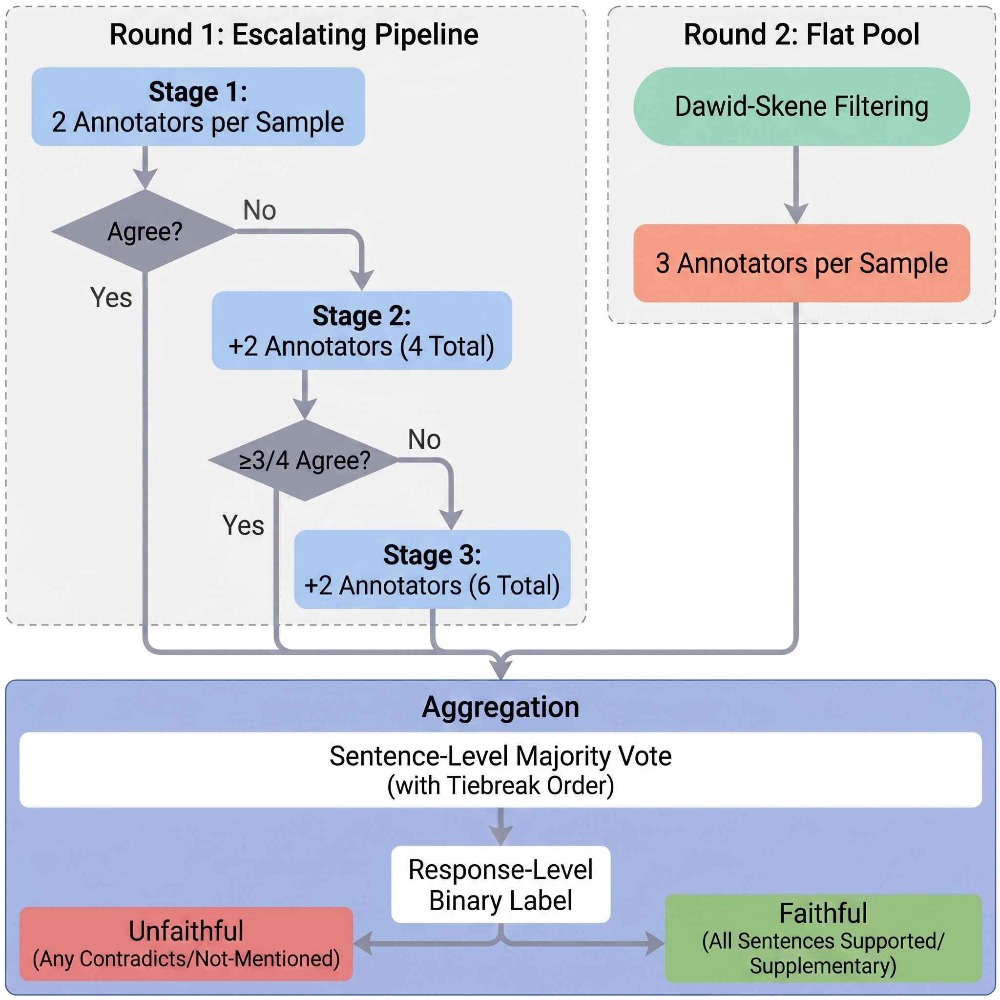

# TRIVIA+ Dataset

[](https://aclanthology.org/2026.acl-long.680.pdf)
[](https://www.amazon.science/publications/rethinking-evaluation-for-llm-hallucination-detection-a-desiderata-a-new-rag-based-benchmark-new-insights)
[](https://arxiv.org/abs/2605.11330)

**A rigorous benchmark for hallucination detection — built against the gaps in every existing one.**

- 94K-char contexts (7–33x longer than prior benchmarks)
- Human-verified, sentence-level labels
- Controlled label noise for robustness testing
- Satisfies all 7 desiderata for evaluation

## Dataset Overview

| Split | Count |
|-------|-------|
| Train | 2,263 |
| Valid | 316   |
| Test  | 645   |
| **Total** | **3,224** |

## Data Sources

The dataset aggregates examples from multiple QA benchmarks:

| Source | Count | Description |
|--------|-------|-------------|
| drop | 1,339 (41.5%) | Discrete Reasoning Over Paragraphs |
| msmarco / ms_marco | 763 (23.7%) | Microsoft Machine Reading Comprehension |
| nq | 674 (20.9%) | Natural Questions |
| trivia | 309 (9.6%) | Trivia Question Answering |
| covid | 139 (4.3%) | COVID-19 scientific literature QA |

**Note:** The `source` column contains both `msmarco` (521) and `ms_marco` (242) as variants for the same origin dataset.

## LLM Response Sources

Responses were generated by three LLMs:

| Model | Count | Description |
|-------|-------|-------------|
| mixtral_8x7b | 1,686 (52.3%) | Mixtral 8x7B |
| claude | 1,006 (31.2%) | Claude (SOTA LLM) |
| gemma | 532 (16.5%) | Gemma 7B |

## Human Annotation

Each sample was annotated at the **sentence level** by multiple annotators (up to 6 per sample) through a rigorous multi-stage pipeline:

1. **Two annotators** label each sample independently
2. On disagreement, **two additional annotators** provide labels
3. If still no clear majority, **two more** labels are gathered
4. Labels are aggregated via majority vote with strictest-label tiebreaking

Annotators were trained over two rounds with author audits. Low-performing annotators were removed using the Dawid-Skene model. Each sentence receives one of four labels: **Supported**, **Contradicted**, **Not Mentioned**, or **Supplementary**.

<p align="center">
  
  <br>
  <em>Multi-vote annotation pipeline with escalating review stages and Dawid-Skene quality filtering.</em>
</p>

## File

**`triviaplus_dataset.parquet`** — Cleaned dataset with all annotations.

See [DATA_DETAILS.md](DATA_DETAILS.md) for complete column descriptions, label aggregation logic, and label distributions.

## Loading the Dataset

```python
import pandas as pd

# Load the dataset
df = pd.read_parquet("triviaplus_dataset.parquet")

# Filter by split
train = df[df['split'] == 'train']
valid = df[df['split'] == 'valid']
test = df[df['split'] == 'test']

# Access sentence-level labels
for idx, row in df.head(3).iterrows():
    print(f"Question: {row['question'][:50]}...")
    print(f"Answer: {row['answer'][:50]}...")
    print(f"Sentences: {row['answer_sentence_list']}")
    print(f"Labels: {row['sentence_level_majority_vote']}")
    print(f"Response label: {row['response_level_label_binary']}")
    print()
```

## Verification

Run the label consistency check:

```bash
python verify_label_consistency.py triviaplus_dataset.parquet
```

## Citation

If you use this dataset, please cite our paper:

```bibtex
@inproceedings{chen-etal-2026-rethinking-evaluation,
    title = "Rethinking Evaluation for {LLM} Hallucination Detection: A Desiderata, A New {RAG}-based Benchmark, New Insights",
    author = "Chen, Wenbo  and
      Padmanabhan, Veena  and
      Giyahchi, Tootiya  and
      Wong, Elaine  and
      Akoglu, Leman",
    editor = "Liakata, Maria  and
      Moreira, Viviane P.  and
      Zhang, Jiajun  and
      Jurgens, David",
    booktitle = "Proceedings of the 64th Annual Meeting of the {A}ssociation for {C}omputational {L}inguistics (Volume 1: Long Papers)",
    month = jul,
    year = "2026",
    address = "San Diego, California, United States",
    publisher = "Association for Computational Linguistics",
    url = "https://aclanthology.org/2026.acl-long.680/",
    doi = "10.18653/v1/2026.acl-long.680",
    pages = "14912--14931",
    ISBN = "979-8-89176-390-6"
}
```

## License

This dataset is licensed under the [Creative Commons Attribution-NonCommercial-NoDerivatives 4.0 International License (CC BY-NC-ND 4.0)](https://creativecommons.org/licenses/by-nc-nd/4.0/).

See the [LICENSE](LICENSE) file for the full license text.
